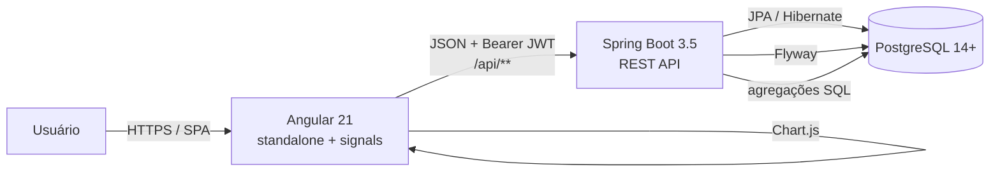
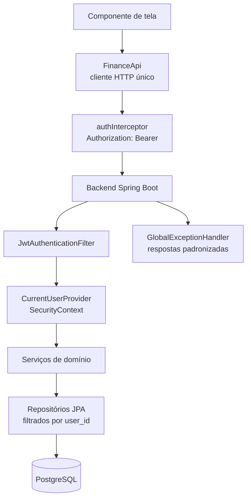
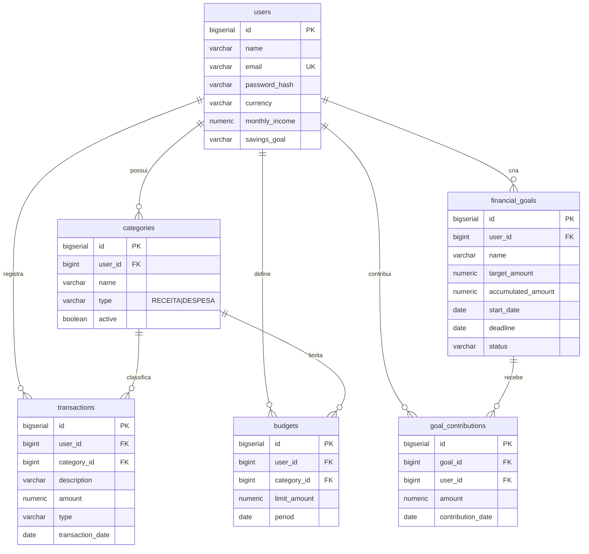

<div align="center">

# FinanSight

**Seu futuro financeiro em boas mãos.**

Plataforma SaaS de gestão e inteligência financeira pessoal — API Java/Spring Boot,
interface Angular e um design system autoral escuro chamado **Midnight**.

[](https://openjdk.org)
[](https://spring.io/projects/spring-boot)
[](https://angular.dev)
[](https://primeng.org)
[](https://www.postgresql.org)
[](#licença)

</div>

---

## Índice

- [Visão geral](#visão-geral)
- [Destaques do projeto](#destaques-do-projeto)
- [Arquitetura](#arquitetura)
- [Stack tecnológica](#stack-tecnológica)
- [Funcionalidades](#funcionalidades)
- [Identidade visual — Midnight](#identidade-visual--midnight)
- [Regras de negócio](#regras-de-negócio)
- [Modelo de dados](#modelo-de-dados)
- [API REST](#api-rest)
- [Como executar](#como-executar)
- [Variáveis de ambiente](#variáveis-de-ambiente)
- [Testes](#testes)
- [Segurança](#segurança)
- [Decisões técnicas](#decisões-técnicas)
- [Estrutura do projeto](#estrutura-do-projeto)
- [Capturas de tela](#capturas-de-tela)
- [Solução de problemas](#solução-de-problemas)
- [Limitações conhecidas](#limitações-conhecidas)
- [Roadmap](#roadmap)
- [Contribuindo](#contribuindo)
- [Licença](#licença)

---

## Visão geral

O FinanSight nasceu para responder a uma pergunta simples: **para onde está indo
o meu dinheiro?** A plataforma permite registrar receitas e despesas, organizar
lançamentos em categorias, definir limites mensais de gasto, criar metas de
economia e analisar a evolução do patrimônio financeiro ao longo do tempo.

O projeto foi construído como **um produto real, e não como uma maquete**:

- todos os botões executam ação;
- todos os formulários validam e persistem;
- todos os filtros alteram os resultados;
- todos os números exibidos vêm do banco de dados;
- nenhuma tela trabalha com dado fictício ou mockado no fluxo principal.

> **Princípio arquitetural central**
> O back-end é a fonte de verdade. Todos os cálculos financeiros, validações de
> negócio e regras de permissão são executados no servidor. A interface apenas
> apresenta os resultados — ela **nunca recalcula um indicador**.

### Quem usa

| Perfil | Ganho principal |
| --- | --- |
| Pessoa física | Visão consolidada de receitas, despesas e saldo acumulado |
| Organizador financeiro | Categorias, orçamentos por categoria e metas com prazo |
| Estudante / portfólio | Projeto full-stack real, testável e documentado |

---

## Destaques do projeto

| Indicador | Valor |
| --- | --- |
| Endpoints REST | 30 rotas em 7 recursos |
| Tabelas no banco | 6 tabelas + 5 índices |
| Testes automatizados | 25 testes JUnit 5 + Mockito |
| Linhas de código (back-end) | ~3.770 (76 arquivos Java) |
| Linhas de código (front-end) | ~8.290 (38 arquivos TS/HTML/SCSS) |
| Componentes reutilizáveis | 10 no design system |
| Telas | 9 áreas funcionais + layout responsivo |
| Design system | Preset autoral "Midnight" (sem template pronto) |
| Cobertura funcional | Autenticação, dashboard, transações, categorias, orçamentos, metas, relatórios, configurações |

---

## Arquitetura





### Divisão de responsabilidades

```
┌────────────────────────────┐        ┌─────────────────────────────────┐
│      FRONT-END (Angular)   │        │      BACK-END (Spring Boot)     │
├────────────────────────────┤        ├─────────────────────────────────┤
│ • apresentação              │  HTTP  │ • autenticação e autorização     │
│ • formulários e validação   │ ─────► │ • regras de negócio              │
│ • gráficos (Chart.js)       │  JSON  │ • agregações (SQL nativo)       │
│ • design system Midnight    │  JWT   │ • persistência (JPA / Flyway)   │
└────────────────────────────┘        └─────────────────────────────────┘
                    │                                     │
                    └──────────────►  PostgreSQL 14+  ◄───┘
```

**Contrato entre as camadas:**

- O front-end envia apenas intenção do usuário (filtros, formulários, navegação).
- O back-end devolve **indicadores prontos** (saldo, economia, percentual usado,
  progresso de meta), já formatados para exibição.
- Regras duplicadas na tela são uma fonte clássica de divergência entre o que
  é exibido e o que está gravado — por isso o projeto as proíbe explicitamente.

---

## Stack tecnológica

### Back-end

| Tecnologia | Versão | Uso no projeto |
| --- | --- | --- |
| Java | 21 | Linguagem principal (`--release 21`) |
| Spring Boot | 3.5.16 | Framework da aplicação e auto-configuração |
| Spring Web | 3.5.16 | Controllers REST e binding de requisições |
| Spring Data JPA | 3.5.16 | Persistência, repositórios e *Specifications* |
| Spring Security | 6.5.x | Autenticação, autorização stateless e CORS |
| Spring Validation | 3.5.16 | Bean Validation nos DTOs de entrada |
| Spring Actuator | 3.5.16 | Health check e métricas operacionais |
| JJWT | 0.12.7 | Emissão e validação de tokens JWT (HS256) |
| PostgreSQL | 14+ | Banco de dados relacional |
| Flyway | 11.x | Migrações versionadas de schema |
| Springdoc OpenAPI | 2.9.1 | Documentação Swagger/OpenAPI 3.1 |
| HikariCP | — | Pool de conexões (10 máx. / 2 ociosos) |
| JUnit 5 / Mockito | 5.x | Testes automatizados |
| H2 | — | Banco em memória usado apenas nos testes |

### Front-end

| Tecnologia | Versão | Uso no projeto |
| --- | --- | --- |
| Angular | 21.2 | Framework (standalone, *signals*, controle de fluxo nativo) |
| TypeScript | 5.9 | Tipagem estrita (`strict`) |
| PrimeNG | 21.1 | Biblioteca de componentes (totalmente customizada) |
| PrimeIcons | 7.0 | Conjunto de ícones |
| @primeuix/themes | 2.0 | Base para o preset "Midnight" |
| Chart.js | 4.5 | Gráficos financeiros (linha, barra e rosca) |
| RxJS | 7.8 | Fluxos reativos e cancelamento de requisições |
| SCSS | — | Design system baseado em tokens |
| Vitest + jsdom | 4.x | Ambiente de teste unitário do front-end |
| Prettier | 3.8 | Padronização de formatação |

---

## Funcionalidades

### Autenticação

- Cadastro de conta com nome, e-mail e senha.
- Login com token **JWT HS256** e expiração configurável (`FINANSIGHT_JWT_EXPIRATION_MINUTES`).
- Senhas armazenadas **apenas** como hash **BCrypt** (custo 12).
- Troca de senha exigindo a senha atual.
- Sessão restaurada ao recarregar a página; expiração devolve o usuário ao login.
- Guardas de rota no front-end **e** validação de autorização no back-end.
- Respostas da API nunca incluem hash de senha.

### Dashboard

- Saudação personalizada e seletor de período (mês, 3/6/12 meses, personalizado).
- Indicadores: **saldo atual**, **receitas**, **despesas** e **economia** do período,
  com comparação percentual contra o período anterior de mesma duração.
- Gráfico de evolução de receitas e despesas — agrupado por dia até 31 dias, por
  mês acima disso.
- Gráfico de rosca com a distribuição de despesas por categoria.
- Transações recentes, metas em andamento e consumo dos orçamentos do mês.
- Todos os agregados vêm de `SUM` / `GROUP BY` / `EXTRACT` no PostgreSQL.

### Transações

- Listagem paginada **server-side** com busca por descrição/observações.
- Filtros combináveis: tipo, categoria, intervalo de datas.
- Ordenação por data, descrição, categoria ou valor (crescente/decrescente).
- Formulário de criação e edição com validação de descrição, valor, tipo,
  categoria, data e observações.
- Exclusão com modal de confirmação.
- Estados de carregamento, sucesso e erro.

### Categorias

- Cadastro, edição, ativação/desativação e exclusão.
- Cada categoria aceita **apenas um tipo** (receita ou despesa); a API recusa
  lançamentos incompatíveis.
- Categorias com transações vinculadas **não podem ser excluídas** — devem ser
  desativadas (`ON DELETE RESTRICT` no banco).
- Nome único por usuário (`UNIQUE (user_id, name)`).

### Orçamentos

- Limite mensal por categoria de despesa.
- Gasto, valor restante e percentual utilizado calculados pelo back-end.
- Situação: **Em dia** (< 70%), **Atenção** (70%–100%) e **Excedido** (> 100%).
- Chave única `(user_id, category_id, period)`, com período sempre no 1º dia do mês.
- Histórico por período.

### Metas financeiras

- Nome, valor desejado, data de início, prazo e descrição.
- Registro de contribuições com histórico por meta.
- Percentual concluído, valor restante, metas concluídas e metas atrasadas.
- Status (`ATIVA`, `CONCLUIDA`, `CANCELADA`) atribuído pelo servidor.
- Conclusão automática quando o acumulado atinge o valor desejado.

### Relatórios

- Total de receitas, despesas e saldo do período.
- Evolução mensal, distribuição por categoria e comparação entre períodos.
- Filtros de data e categoria.
- Exportação **CSV** com BOM UTF-8, separador `;` e formato brasileiro
  (datas `dd/MM/aaaa`, valores com vírgula decimal).

### Configurações

- Perfil: nome, renda mensal e meta de economia.
- Alteração de senha (com confirmação da senha atual).
- Dados da conta: moeda padrão e data de criação.

---

## Identidade visual — Midnight

A direção de arte **Midnight** foi desenhada para o FinanSight e não reaproveita
nenhum template pronto. O tema padrão do PrimeNG (Aura) é reescrito token a token.

### Paleta

| Token | Valor | Uso |
| --- | --- | --- |
| `--fs-bg-primary` | `#07111F` | Fundo da página |
| `--fs-bg-secondary` | `#0A1524` | Menu lateral, superfícies de apoio |
| `--fs-surface` | `#0D192A` | Cartões |
| `--fs-surface-elevated` | `#101E32` | Elementos sobre cartões |
| `--fs-surface-selected` | `#172A44` | Item ativo, seleção |
| `--fs-border` | `#20314A` | Bordas |
| `--fs-accent` | `#6B8EFF` | Azul principal (ações, gráficos) |
| `--fs-accent-soft` | `#8FB3D9` | Azul secundário |
| `--fs-accent-light` | `#B8D3F5` | Azul claro (destaques) |
| `--fs-text-primary` | `#E8EEF7` | Texto principal |
| `--fs-text-secondary` | `#91A1B8` | Texto auxiliar |
| `--fs-text-muted` | `#71839B` | Texto discreto |
| `--fs-success` | `#48C6AD` | Receitas, dentro do orçamento |
| `--fs-danger` | `#E58B93` | Despesas, exclusão |
| `--fs-warning` | `#D9B779` | Atenção, meta atrasada |
| `--fs-info` | `#8FB3D9` | Informações neutras |

As cores semânticas aparecem **apenas** quando há informação a transmitir.
Nenhum cartão recebe cor decorativa própria.

### Marca

O símbolo é um vetor SVG original (`frontend/src/assets/finansight-mark.svg`):
uma lente aberta com uma tendência ascendente e um ponto focal — a combinação de
*visão* e *crescimento*. Funciona ao lado do nome, isolado no menu, no favicon e
nas telas de carregamento.

### Tipografia

Inter, com pesos 400/500/600/700. Valores monetários usam numerais tabulares
(`font-variant-numeric: tabular-nums`) para alinhar colunas e são formatados no
padrão brasileiro (`R$ 8.450,32`).

### Design system

- Tokens SCSS globais em `frontend/src/styles/_tokens.scss`.
- Preset PrimeNG "Midnight" em `frontend/src/styles/midnight-theme.ts`, que
  reescreve tokens semânticos (superfícies, textos, campos, overlays) e as seções
  de cada componente — botões, inputs, selects, tabelas, diálogos, toasts,
  paginador, barras de progresso, calendário, menus e tooltips.
- Componentes reutilizáveis:

| Componente | Responsabilidade |
| --- | --- |
| `fs-stat-card` | Cartão de indicador com valor, rótulo e variação |
| `fs-trend-indicator` | Variação percentual (alta/baixa/neutra) |
| `fs-progress-meter` | Barra de progresso semântica (orçamento/meta) |
| `fs-empty-state` | Estado vazio com ação sugerida |
| `fs-page-header` | Cabeçalho de página com título, eyebrow e ações |
| `fs-finance-chart` | Wrapper do Chart.js (linha, barra e rosca) |
| `fs-period-selector` | Seleção de período (mês, 3/6/12, personalizado) |
| `fs-confirm-dialog` | Diálogo de confirmação padronizado |
| `fs-auth-layout` | Layout compartilhado das telas de autenticação |
| `fs-brand-logo` | Marca (ícone + wordmark) |

### Acessibilidade

- Todos os campos têm `<label for>` associado.
- Foco visível (`:focus-visible` com contorno de 2px na cor de destaque).
- Estados de erro com **texto**, não apenas cor.
- Ícones decorativos com `aria-hidden`; botões de ícone com `aria-label`.
- Gráficos com `role="img"` e `aria-label` descritivo.
- `prefers-reduced-motion` respeitado globalmente.

---

## Regras de negócio

Documentadas também no código (`AnalyticsService`, `BudgetRules`, `GoalService`,
`PeriodResolver`) e cobertas por testes unitários.

| Regra | Definição |
| --- | --- |
| Saldo atual | Soma de **todas** as receitas menos **todas** as despesas com data até o fim do período selecionado (saldo acumulado). |
| Receitas / despesas do período | Somente transações com data dentro do intervalo selecionado. |
| Economia do período | `receitas do período − despesas do período`. |
| Comparação | Período anterior de mesma duração; sem dados, a variação é omitida. |
| Gasto do orçamento | Despesas da categoria dentro do mês do orçamento. |
| Situação do orçamento | `EM_DIA` (< 70%), `ATENCAO` (70%–100%), `EXCEDIDO` (> 100%). |
| Valor restante | Nunca negativo (limitado a zero). |
| Percentual utilizado | `(gasto ÷ limite) × 100`, com 2 casas decimais (`HALF_UP`). |
| Progresso da meta | `acumulado ÷ desejado × 100`, com 2 casas decimais. |
| Meta concluída | O acumulado atinge ou ultrapassa o valor desejado. |
| Meta atrasada | Prazo anterior a hoje e meta ainda ativa. |
| Valor acumulado da meta | Soma das contribuições registradas (fonte: banco). |
| Compatibilidade | Uma transação `RECEITA` exige categoria do tipo `RECEITA` (idem para despesa). |
| Categoria inativa | Não aceita novos lançamentos. |
| Isolamento | Toda consulta é filtrada por `user_id`; recurso alheio responde `404`. |

### Fórmulas

```text
saldo_atual   = Σ receitas(≤ fim do período) − Σ despesas(≤ fim do período)
economia      = Σ receitas(período)      − Σ despesas(período)
comparação    = (período atual − período anterior) ÷ período anterior
gasto_orç.    = Σ despesas da categoria dentro do mês do orçamento
%_utilizado   = (gasto_orç. ÷ limite) × 100
restante      = max(limite − gasto_orç., 0)
progresso_meta= (Σ contribuições ÷ valor desejado) × 100
```

### Precisão monetária

Valores monetários usam `BigDecimal` com escala 2 no Java e `number` no
TypeScript — **nunca** `float`/`double`. No banco, `numeric(19,2)` garante
centavos exatos, sem arredondamento binário. O arredondamento é explícito e
sempre `HALF_UP` com 2 casas.

---

## Modelo de dados



### Tabelas

| Tabela | Colunas principais | Restrições |
| --- | --- | --- |
| `users` | `name`, `email`, `password_hash`, `currency`, `monthly_income`, `savings_goal` | `email` único |
| `categories` | `name`, `type`, `description`, `active` | `UNIQUE (user_id, name)`, `CHECK type` |
| `transactions` | `description`, `amount`, `type`, `transaction_date`, `notes` | `CHECK amount > 0`, `ON DELETE RESTRICT` na categoria |
| `budgets` | `limit_amount`, `period` | `UNIQUE (user_id, category_id, period)`, `CHECK limit_amount > 0` |
| `financial_goals` | `name`, `target_amount`, `accumulated_amount`, `start_date`, `deadline`, `status` | `CHECK status`, `CHECK target_amount > 0` |
| `goal_contributions` | `amount`, `contribution_date`, `note` | `CHECK amount > 0` |

### Índices

| Índice | Tabela | Colunas | Motivo |
| --- | --- | --- | --- |
| `idx_transactions_user_date` | transactions | `user_id, transaction_date` | Filtro por usuário + período (consulta mais frequente) |
| `idx_transactions_category` | transactions | `category_id` | Filtro por categoria |
| `idx_budgets_user_period` | budgets | `user_id, period` | Listagem de orçamentos do mês |
| `idx_goals_user` | financial_goals | `user_id` | Listagem de metas |
| `idx_contributions_goal` | goal_contributions | `goal_id` | Histórico de contribuições |

### Estratégia de migração

As migrações ficam em `backend/src/main/resources/db/migration` e são aplicadas
automaticamente pelo **Flyway** na inicialização da API (`baseline-on-migrate:
true`). O Hibernate opera com `ddl-auto: validate` — ele **nunca** cria ou
altera schema; o schema é sempre versionado no Flyway.

---

## API REST

Base: `http://localhost:8080` · Documentação interativa: `/swagger-ui.html` ·
OpenAPI 3.1 em `/v3/api-docs`.

### Autenticação

| Método | Rota | Descrição | Auth |
| --- | --- | --- | --- |
| `POST` | `/api/auth/register` | Cadastro (devolve token) | — |
| `POST` | `/api/auth/login` | Login (devolve token) | — |
| `GET` | `/api/auth/me` | Perfil do usuário autenticado | Bearer |
| `PUT` | `/api/auth/profile` | Atualização de perfil | Bearer |
| `PUT` | `/api/auth/password` | Troca de senha | Bearer |

### Transações

| Método | Rota | Descrição |
| --- | --- | --- |
| `GET` | `/api/transactions` | Lista paginada com filtros e ordenação |
| `GET` | `/api/transactions/{id}` | Detalha uma transação |
| `POST` | `/api/transactions` | Cria uma transação |
| `PUT` | `/api/transactions/{id}` | Atualiza uma transação |
| `DELETE` | `/api/transactions/{id}` | Exclui uma transação |

**Parâmetros de `GET /api/transactions`:**

| Parâmetro | Tipo | Padrão | Descrição |
| --- | --- | --- | --- |
| `search` | `string` | — | Busca em descrição e observações |
| `type` | `RECEITA` \| `DESPESA` | — | Filtro por tipo |
| `categoryId` | `long` | — | Filtro por categoria |
| `from` / `to` | `date` (ISO) | — | Intervalo de datas |
| `sortBy` | `date` \| `description` \| `category` \| `amount` | `date` | Campo de ordenação |
| `direction` | `asc` \| `desc` | `desc` | Direção da ordenação |
| `page` | `int` | `0` | Página (base 0) |
| `size` | `int` | `10` | Itens por página |

### Categorias, orçamentos e metas

| Recurso | Rotas |
| --- | --- |
| `GET/POST/PUT/DELETE /api/categories` | Categorias (`GET` aceita `onlyActive`) |
| `GET/POST/PUT/DELETE /api/budgets` | Orçamentos (`GET` aceita `from`/`to`) |
| `GET/POST/PUT/DELETE /api/goals` | Metas financeiras (`GET` aceita `status`) |
| `GET/POST/DELETE /api/goals/{id}/contributions` | Contribuições das metas |

### Dashboard e relatórios

| Método | Rota | Descrição | Parâmetros |
| --- | --- | --- | --- |
| `GET` | `/api/dashboard` | Indicadores consolidados do período | `from`, `to` |
| `GET` | `/api/reports` | Relatório analítico do período | `from`, `to`, `categoryId` |
| `GET` | `/api/reports/export` | Exportação CSV (`text/csv`) | `from`, `to`, `categoryId` |

### Operação

| Rota | Descrição |
| --- | --- |
| `GET /actuator/health` | Health check (sem detalhes expostos) |
| `GET /v3/api-docs` | Documento OpenAPI 3.1 |
| `GET /swagger-ui.html` | Swagger UI interativo |

### Formato de erro

Todas as respostas de erro seguem o mesmo contrato (`GlobalExceptionHandler`):

```json
{
  "timestamp": "2026-01-15T12:34:56.789Z",
  "status": 400,
  "error": "Bad Request",
  "message": "Dados inválidos",
  "path": "/api/transactions",
  "fields": {
    "amount": "valor deve ser maior que zero"
  }
}
```

| Status | Quando ocorre |
| --- | --- |
| `400 Bad Request` | Validação de campos (`fields` lista os erros) ou argumento inválido |
| `401 Unauthorized` | Credenciais inválidas ou token ausente/expirado |
| `403 Forbidden` | Token válido, porém sem permissão |
| `404 Not Found` | Recurso inexistente **ou pertencente a outro usuário** |
| `409 Conflict` | Regra de negócio violada (ex.: excluir categoria em uso) |
| `500 Internal Server Error` | Erro inesperado (sem stack trace na resposta) |

### Exemplos

```bash
# Login
curl -X POST http://localhost:8080/api/auth/login \
  -H "Content-Type: application/json" \
  -d '{"email":"demo@finansight.app","password":"demo1234"}'

# Dashboard do mês corrente
curl -H "Authorization: Bearer $TOKEN" \
  "http://localhost:8080/api/dashboard"

# Transações com filtros
curl -H "Authorization: Bearer $TOKEN" \
  "http://localhost:8080/api/transactions?type=DESPESA&size=20&sortBy=amount&direction=desc"

# Exportação CSV
curl -H "Authorization: Bearer $TOKEN" \
  "http://localhost:8080/api/reports/export?from=2026-01-01&to=2026-01-31" \
  -o relatorio.csv
```

---

## Como executar

### Pré-requisitos

| Item | Versão |
| --- | --- |
| JDK | 21+ (21, 22, 23 ou 24 — o projeto compila com `--release 21`) |
| Maven | 3.9+ (ou o wrapper `mvnw` incluído no projeto) |
| Node.js | 20.19+ / 22.12+ / 24+ |
| npm | 10+ |
| PostgreSQL | 14+ rodando localmente (Docker não é obrigatório) |
| Navegador | Chrome, Edge, Firefox ou Safari recentes |

### Passo 1 — Banco de dados

```bash
# cria o papel e o banco (ajuste a senha conforme sua instalação)
psql -U postgres -c "CREATE USER finansight WITH PASSWORD 'finansight';"
psql -U postgres -c "CREATE DATABASE finansight OWNER finansight;"
```

As migrações do Flyway são aplicadas automaticamente na inicialização da API —
não é preciso rodar script manualmente.

### Passo 2 — Variáveis de ambiente

Copie `.env.example` para `.env` e ajuste os valores. No Windows PowerShell:

```powershell
$env:DB_URL="jdbc:postgresql://localhost:5432/finansight"
$env:DB_USER="finansight"
$env:DB_PASSWORD="finansight"
$env:FINANSIGHT_JWT_SECRET="um-segredo-longo-e-aleatorio-por-favor-troque-este"
$env:FINANSIGHT_DEMO_ENABLED="true"
```

> Em produção, use sempre um segredo forte e mantenha
> `FINANSIGHT_DEMO_ENABLED=false`.

### Passo 3 — Back-end

```bash
cd backend
mvn spring-boot:run
# ou
mvn clean package && java -jar target/finansight-backend-1.0.0.jar
```

| Serviço | URL |
| --- | --- |
| API | <http://localhost:8080> |
| Swagger UI | <http://localhost:8080/swagger-ui.html> |
| Health check | <http://localhost:8080/actuator/health> |

### Passo 4 — Front-end

```bash
cd frontend
npm install
npm start
```

- Aplicação: <http://localhost:4200>

O servidor de desenvolvimento encaminha as chamadas de `/api` para o back-end via
`proxy.conf.js`. Para apontar para outro endereço:

```bash
PROXY_TARGET=http://localhost:8080 npm start
```

### Conta de demonstração

Com `FINANSIGHT_DEMO_ENABLED=true`, o seed cria uma conta isolada com
**6 meses de histórico**, 9 categorias, 4 orçamentos e 3 metas com contribuições.

| E-mail | Senha |
| --- | --- |
| `demo@finansight.app` | `demo1234` |

> Esses dados são de **demonstração** e ficam separados dos dados de qualquer
> conta real. Para começar do zero, cadastre-se pela tela de criação de conta.

### Execução completa (do zero)

```bash
# terminal 1 — API
cd backend && mvn spring-boot:run

# terminal 2 — interface
cd frontend && npm install && npm start
```

Acesse <http://localhost:4200> e entre com `demo@finansight.app` / `demo1234`.

---

## Variáveis de ambiente

| Variável | Padrão | Descrição |
| --- | --- | --- |
| `SERVER_PORT` | `8080` | Porta da API |
| `DB_URL` | `jdbc:postgresql://localhost:5432/finansight` | JDBC do PostgreSQL |
| `DB_USER` | `finansight` | Usuário do banco |
| `DB_PASSWORD` | `finansight` | Senha do banco |
| `FINANSIGHT_JWT_SECRET` | *(dev)* | Segredo de assinatura do JWT — **obrigatório em produção** |
| `FINANSIGHT_JWT_EXPIRATION_MINUTES` | `720` (12 h) | Validade do token |
| `FINANSIGHT_ALLOWED_ORIGINS` | `http://localhost:4200` | Origens permitidas no CORS (separadas por vírgula) |
| `FINANSIGHT_DEMO_ENABLED` | `false` | Cria a conta de demonstração ao iniciar |
| `PROXY_TARGET` | `http://localhost:8080` | Back-end usado pelo proxy de desenvolvimento |

> `.env` está no `.gitignore` e o repositório traz um `.env.example` com a
> lista completa. Nunca comite credenciais reais.

---

## Testes

### Back-end

```bash
cd backend
mvn test
```

**25 testes automatizados** cobrindo as regras mais importantes:

| Classe | Testes | O que garante |
| --- | --- | --- |
| `BudgetRulesTest` | 5 | Faixas de atenção/excedido, percentual e valor restante. |
| `AnalyticsServiceTest` | 4 | Saldo acumulado, economia do período, comparação e distribuição. |
| `TransactionServiceTest` | 5 | Compatibilidade tipo × categoria, categoria inativa, normalização de valores e isolamento entre usuários. |
| `GoalServiceTest` | 4 | Contribuições, conclusão automática, prazo inválido e meta atrasada. |
| `AuthServiceTest` | 3 | Hash da senha, e-mail duplicado e ausência de senha na resposta. |
| `PeriodResolverTest` | 3 | Padrões e correção de período. |
| `FinanSightApplicationTests` | 1 | Carregamento do contexto (segurança, JPA, OpenAPI). |

Estratégia: **JUnit 5 + Mockito** para as regras de negócio e **H2** em memória
para a infraestrutura, o que mantém a suíte rápida e determinística.

### Front-end

```bash
cd frontend
npm run build   # verificação de tipagem e bundle de produção
npm test        # testes unitários (Vitest + jsdom)
```

---

## Segurança

| Camada | Mecanismo |
| --- | --- |
| Senha | BCrypt (custo 12) — nunca em texto puro, nunca devolvida pela API |
| Sessão | JWT **HS256** stateless, expiração configurável, segredo via variável de ambiente |
| Transporte | `Authorization: Bearer <token>` injetado por `authInterceptor` |
| Autorização | `CurrentUserProvider` resolve o usuário do `SecurityContext`; **todo** repositório é filtrado por `user_id` |
| Isolamento | Um usuário não consegue ler nem alterar dados de outro — verificado com duas contas reais (recursos alheios retornam `404`) |
| Validação | Bean Validation + `GlobalExceptionHandler` com respostas JSON padronizadas |
| CORS | Restrito às origens de `FINANSIGHT_ALLOWED_ORIGINS` |
| Segredos | Fora do código: `.env` no `.gitignore` + `.env.example` versionado |

### Checklist de produção

- [ ] Definir `FINANSIGHT_JWT_SECRET` forte (ex.: `openssl rand -base64 48`)
- [ ] Definir `FINANSIGHT_DEMO_ENABLED=false`
- [ ] Restringir `FINANSIGHT_ALLOWED_ORIGINS` ao domínio real
- [ ] Usar credenciais de banco com privilégio mínimo (apenas o schema `finansight`)
- [ ] Servir a API atrás de HTTPS (o front-end envia o token em toda requisição)
- [ ] Habilitar backup do PostgreSQL

---

## Decisões técnicas

- **PrimeNG 21 em vez do 22.** A versão 22 exige uma licença PrimeUI paga e
  exibe um aviso de "Invalid PrimeUI License" na tela. A versão 21 é a última
  sem licenciamento e mantém a mesma API de componentes — o projeto pode ser
  atualizado para a 22 adicionando apenas a chave `license` em `providePrimeNG`.
- **Chart.js diretamente** (em vez do wrapper `p-chart`) para controlar linhas,
  grades, tooltips e a legenda em HTML do gráfico de rosca.
- **Consultas agregadas no banco** (`SUM`, `GROUP BY`, `EXTRACT`) para o
  dashboard e os relatórios — o front-end nunca recalcula indicador.
- **Specifications JPA** na listagem de transações para combinar busca, tipo,
  categoria, período e ordenação em uma única consulta parametrizada (sem
  concatenação de SQL).
- **Token em `localStorage`**, com interceptor HTTP injetando o cabeçalho
  `Authorization` e devolvendo o usuário ao login em caso de `401`.
- **`ddl-auto: validate`** com Flyway: o schema é sempre versionado, nunca
  inferido pelo Hibernate.
- **Value objects de domínio** (`BudgetRules`, `PeriodResolver`) isolados do
  framework, o que os torna testáveis sem contexto de Spring.
- **Rota por feature no front-end** com *lazy loading* (`loadComponent`),
  reduzindo o bundle inicial.

---

## Estrutura do projeto

```
finansight/
├── backend/                    # API Java / Spring Boot
│   ├── src/main/java/com/finansight/
│   │   ├── config/             # segurança, tema OpenAPI, seed de demonstração
│   │   ├── controller/         # controllers REST
│   │   ├── domain/             # entidades e enums
│   │   ├── dto/                # contratos de entrada e saída
│   │   ├── exception/          # tratamento centralizado de erros
│   │   ├── repository/         # Spring Data JPA
│   │   ├── security/           # JWT, filtros e resolução do usuário
│   │   ├── service/            # regras de negócio
│   │   └── support/            # utilitários (período)
│   ├── src/main/resources/
│   │   ├── db/migration/       # migrações Flyway (V1__init.sql)
│   │   └── application.yml
│   ├── src/test/               # JUnit 5 + Mockito
│   ├── mvnw / mvnw.cmd         # Maven wrapper
│   └── pom.xml
├── frontend/                   # SPA Angular
│   ├── src/app/
│   │   ├── core/               # modelos, serviço HTTP, interceptor, guard, formatos
│   │   │   ├── config/         # configuração da API
│   │   │   ├── guards/         # authGuard / guestGuard
│   │   │   ├── interceptors/   # injeção do Bearer token
│   │   │   ├── models/         # contratos tipados da API
│   │   │   ├── services/       # FinanceApi + SessionService
│   │   │   └── utils/          # formatação (moeda, data, percentual)
│   │   ├── layout/             # app-shell, sidebar, topbar
│   │   ├── shared/             # design system reutilizável (10 componentes)
│   │   │   ├── components/     # fs-stat-card, fs-finance-chart, ...
│   │   │   └── pipes/          # pipes de formatação
│   │   ├── features/           # telas (auth, dashboard, transactions, ...)
│   │   └── styles/             # tokens SCSS e preset PrimeNG
│   ├── proxy.conf.js           # proxy /api para o back-end
│   └── package.json
├── docs/                       # imagens e notas de arquitetura
├── .env.example
├── .gitignore
├── LICENSE
└── README.md
```

---

## Capturas de tela

| Tela | Arquivo |
| --- | --- |
| Login | `docs/01-login.png` |
| Cadastro | `docs/02-cadastro.png` |
| Dashboard | `docs/03-dashboard.png` |
| Transações | `docs/04-transacoes.png` |
| Categorias | `docs/05-categorias.png` |
| Orçamentos | `docs/06-orcamentos.png` |
| Metas financeiras | `docs/07-metas.png` |
| Relatórios | `docs/08-relatorios.png` |
| Configurações | `docs/09-configuracoes.png` |
| Layout mobile | `docs/10-mobile-dashboard.png` |
| Diálogo de nova transação | `docs/11-dialog-transacao.png` |
| Menu lateral recolhido | `docs/12-sidebar-recolhido.png` |

> As notas técnicas de arquitetura estão em [`docs/arquitetura.md`](docs/arquitetura.md).

---

## Solução de problemas

| Sintoma | Causa provável | Solução |
| --- | --- | --- |
| `Connection refused` na API | PostgreSQL parado ou `DB_URL` incorreta | Verifique o serviço e as variáveis `DB_*` |
| `Flyway ... validate failed` | Schema divergente das migrações | Ajuste o schema manualmente ou recrie o banco de demonstração |
| `401` em toda requisição | Token expirado ou `FINANSIGHT_JWT_SECRET` alterado entre sessões | Faça login novamente; reinicie a API para invalidar tokens antigos |
| `403` ao acessar recurso | Recurso pertence a outro usuário | Comportamento esperado — o isolamento retorna `404`/`403` |
| Front-end não carrega dados | Proxy apontando para a porta errada | Ajuste `PROXY_TARGET` (padrão `http://localhost:8080`) |
| `npm start` falha na porta 4200 | Porta ocupada por outra instância | Encerre o processo anterior ou defina `--port` |
| Erro de CORS no console | Origem não liberada | Inclua a URL do front-end em `FINANSIGHT_ALLOWED_ORIGINS` |
| `Invalid PrimeUI License` | PrimeNG 22 instalado | Fixar a versão em `21.x` (`npm i primeng@^21.1.10`) |

---

## Limitações conhecidas

- **Recuperação de senha por e-mail** não foi implementada (exige um serviço de
  e-mail transacional). A troca de senha autenticada está disponível.
- **Gráfico de pizza com muitas categorias**: o doughnut exibe as fatias sem
  rótulo interno; os valores e percentuais ficam na legenda ao lado, que
  permanece legível em todas as larguras.
- **O seed de demonstração** recria os dados apenas se a conta de demonstração
  ainda não existir. Para recriá-los, remova o usuário `demo@finansight.app`.
- **Sem multiusuário por Household**: cada usuário tem uma base isolada e
  independente.
- **Paginação da tabela de transações é server-side**; a ordenação disponível
  cobre data, descrição, categoria e valor.
- **Sem cache de agregações**: o dashboard recalcula a cada carregamento.

---

## Roadmap

Ideias de evolução natural do projeto, em ordem de prioridade:

- [ ] Envio de e-mail transacional para recuperação de senha
- [ ] Importação de extratos bancários (OFX/CSV) com deduplicação
- [ ] Metas compartilhadas entre household (familiar)
- [ ] Relatórios comparando anos distintos
- [ ] Cache das agregações do dashboard para grandes volumes de dados
- [ ] Notificações de orçamento estourado e metas próximas do prazo
- [ ] Suporte a múltiplas moedas com câmbio

---

## Contribuindo

1. Crie uma branch a partir de `main` (`git checkout -b feature/minha-mudanca`).
2. Mantenha o estilo do código: **2 espaços** (front-end), indentação de 4
   espaços e *Google Java Style* (back-end), formatação validada pelo Prettier.
3. **Back-end:** toda regra de negócio nova precisa de teste unitário em
   `backend/src/test/java/com/finansight/`.
4. **Front-end:** rode `npm run build` antes de abrir o PR (valida tipagem
   estrita e o bundle de produção).
5. Atualize a documentação affected (README, `docs/arquitetura.md`, Swagger).
6. Abra o Pull Request descrevendo **o que** mudou e **por quê**.

Commits seguem [Conventional Commits](https://www.conventionalcommits.org/)
(`feat:`, `fix:`, `docs:`, `refactor:`, `test:`, `chore:`).

---

## Licença

Projeto acadêmico/portfólio, distribuído sob a licença **MIT**. Veja o arquivo
[`LICENSE`](LICENSE) para o texto completo.

<div align="center">

**[⬆ Voltar ao topo](#finansight)**

Feito com ☕, Java 21 e Angular 21.

</div>
